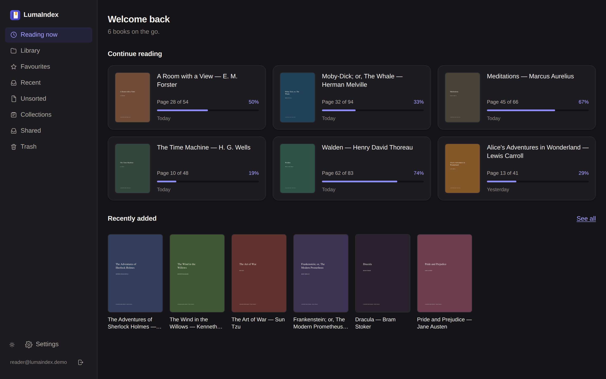
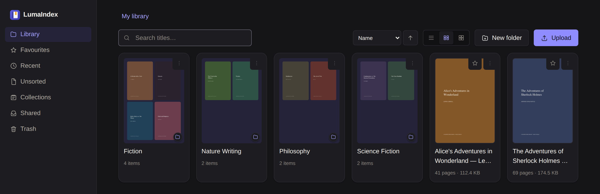
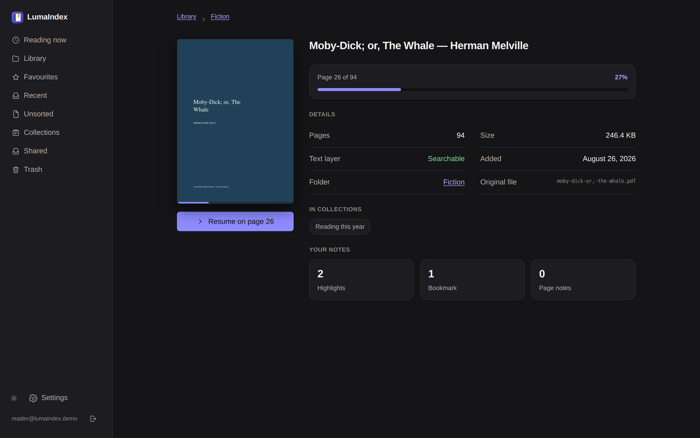
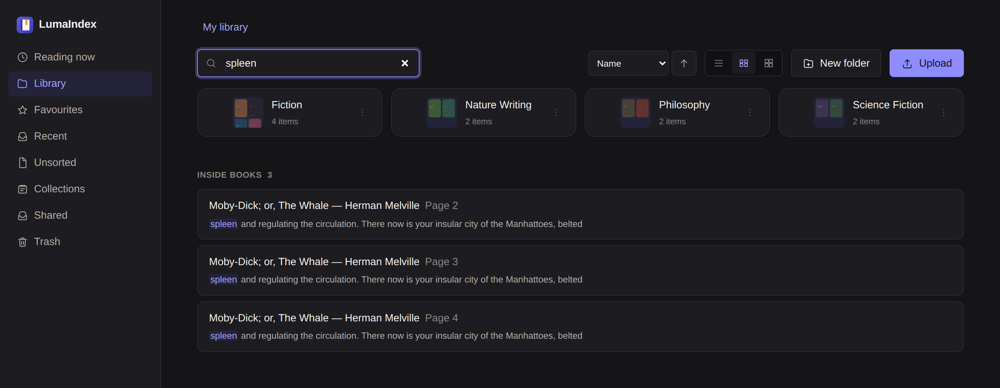
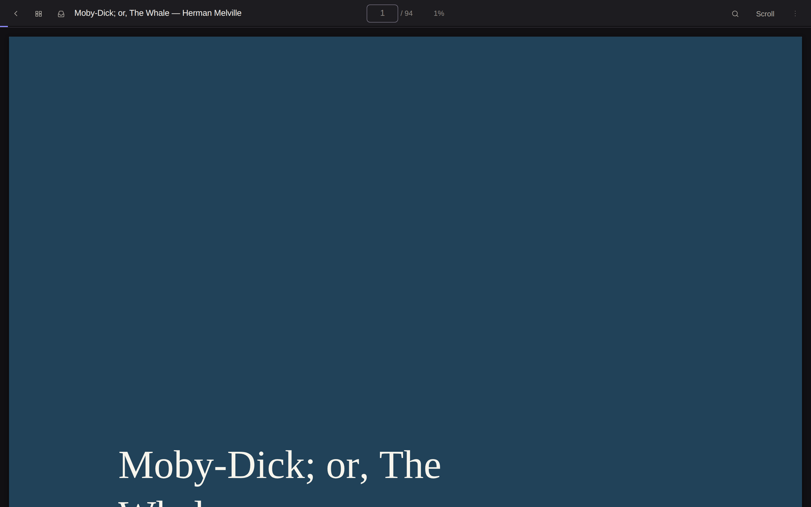
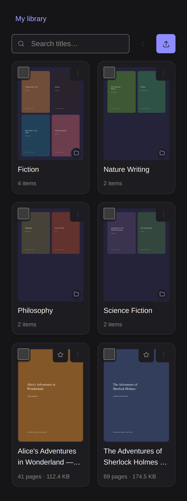

# LumaIndex

A self-hosted PDF library and reader for a household or a small team.

Upload your PDFs, organise them in folders, and read them in the browser — on a
desktop, a tablet, or a phone. Books are private until you share one, and every
reader keeps their own place, bookmarks, highlights, and notes.

Five containers on one Ubuntu machine — PostgreSQL, Django, Nuxt, Caddy, and a
background worker. One port reaches the host, on loopback, so whatever you put
in front of it — [Tailscale](https://tailscale.com), nginx, anything — needs a
single upstream and the app is never exposed by accident.

> [`lumaindex-prd.md`](lumaindex-prd.md) is the original spec and still governs
> the reader, sharing, and annotations. Its storage chapters do not: they
> assumed Google Drive was canonical storage, which was built and then replaced
> by direct uploads. Where the two disagree about storage, this README is
> current.

---

## What it does

| | |
| --- | --- |
| **Upload** | Drag PDFs onto the page or onto a folder. Large files go in pieces and resume if the connection drops. A ZIP has its folder structure rebuilt. Identical files are stored once. |
| **Organise** | Folders you create, rename, and delete. Drag to move, or use the row picker. Tick several — shift-click for a run — and move, trash, favourite or collect them at once. Folders wear a mosaic of the covers inside them. Sort by name, date added, last modified, size, or type. |
| **Find** | Search titles, or search *inside* books — every page of a book with a text layer is indexed, and a result takes you to the page it is on. Scans stay unsearchable, and say so. |
| **Read** | PDF.js: continuous scroll or single page, zoom, text selection, in-book search, outline sidebar, page thumbnails. The toolbar hides as you read forward and returns when you scroll up. |
| **Resume** | Your place is saved as you read and picked up on any other device, and the app opens on what you are part way through rather than on a folder browser. |
| **Annotate** | Bookmarks, highlights in four colours, notes on a highlight, and page notes for scans with no text layer. |
| **Notebook** | Every highlight and note from every book in one list — search it, narrow it by colour or by book from the list down the side, read one book's notes in page order, and open any entry at its page. Copy a passage with its source, add or edit a note, or delete one, without opening the book. A few highlights come back on the home page each day. |
| **Export** | A book's highlights, notes and bookmarks — or all of them — as Markdown, page by page, for Obsidian, Logseq, Notion or a text editor. |
| **Habit** | Today's pages against an optional goal, and your streak, beside the welcome; the last seven days and this year further down, after the book you came back for. A page counts when you arrive on it, on your own calendar day. |
| **Quick open** | ⌘K (Ctrl K) on any page jumps to a book by title, to any section, or into a search. |
| **Collect** | Star a favourite, or gather books into collections that cut across folders. |
| **Share** | Mark a book shared and anyone signed in can read it — keeping their own place and notes. |
| **On a phone** | Add to the Home Screen and it runs without browser chrome. Navigation moves to a tab bar within thumb reach, the library toolbar collapses to a single row, and the reader's secondary controls fold into one menu. |

**Deliberately not:** EPUB, OCR, AI features, public sign-up, anonymous reading,
or sharing with named people or groups — sharing is all-or-nothing within the
instance. These are the PRD's non-goals (§42).

---

## Screenshots



LumaIndex opens on what you are part way through. The endpoint behind this
shelf had existed since Phase 4 with nothing calling it, while the front door
showed a folder browser — an answer to a question you ask when you are filing,
not when you sit down to read.



Browsing lives at `/library`. Folders are rows rather than portrait tiles, so a
folder no longer has the shape of a book; each wears a mosaic of the covers
inside it, composited in the browser from covers already on the page, so there
is no stored folder image to invalidate when its contents change. How far into
a book you are rides on the cover, where you are already looking.



Where a book came from, who can see it, what you have filed it under and what
you have written on it — reached from a row menu or from the reader, never in
front of opening a book, because reading is the fast path.



The title filter narrows the grid as you type; underneath it, the pages that
contain the word, with the sentence they were found in. Following one opens the
book at that page.



Seven controls where there were fifteen; the rest are in one menu. The page
arrows appear only in single-page mode, where they are the only way to turn a
page. The line under the bar is how far through the book you are.



Navigation sits in a tab bar within thumb reach instead of a row of chips above
the content, and the toolbar collapses to a single row: search takes the width,
sort and view and New folder fold into one menu. Five rows of chrome became
two, and the first cover moved from halfway down the screen to just under the
search field.

All six are a demo library of public-domain books, generated by
[`scripts/demo_library.py`](scripts/demo_library.py) and captured by
[`scripts/screenshots.sh`](scripts/screenshots.sh) against a scratch instance —
reproducible, and nobody's real shelf.

---

## How it works

Four diagrams, because these four things fail and change independently.

### Getting in

```text
             your devices
                  │
                  │  https://<your-origin>
                  ▼
      ┌───────────────────────┐   tailscale serve, nginx, anything:
      │  whatever terminates  │   not this project's business, and
      │           TLS         │   there is exactly one seam
      └───────────┬───────────┘
                  │  http://127.0.0.1:8080   ← the only published port
                  ▼
           ┌─────────────────┐
           │      Caddy      │   one origin, so no CORS and the session
           └──┬───────────┬──┘   cookie stays SameSite=Lax
   /api /admin│           │everything else
              ▼           ▼
        ┌──────────┐  ┌────────┐
        │  Django  │  │ Nuxt 3 │
        │  + DRF   │  │ PDF.js │
        └──────────┘  └────────┘
```

**One port reaches the host.** Caddy binds `127.0.0.1:8080` and nothing else is
published at all, so the app is never exposed to the LAN or the internet by
accident — whatever fronts it needs a single upstream.

| Port | What | Reachable from |
| --- | --- | --- |
| **8080** | Caddy | the host, on loopback only — move it with `LUMA_BIND_ADDRESS` and `CADDY_HTTP_PORT` |
| 8000 | Django (gunicorn) | the compose network |
| 3000 | Nuxt | the compose network |
| 5432 | PostgreSQL | the compose network |

Three settings have to agree with the origin your proxy serves, and each fails
quietly in its own way: `LUMA_PUBLIC_ORIGIN`, `DJANGO_CSRF_TRUSTED_ORIGINS`
(a mismatch fails logins with a message that never mentions the origin), and
`LUMA_NUM_PROXIES` (proxy plus Caddy is two hops). The proxy must forward
`X-Forwarded-Proto`, or Django decides the request was plain HTTP and declines
to set a `Secure` cookie — which looks like a login that works and then does
nothing.

### Where the data sits

```text
        ┌──────────────┐
        │ Django + DRF │  auth · authorization · uploads · PDF delivery
        └───┬──────┬───┘
            ▼      ▼
  ┌────────────┐  ┌───────────────────────────────────────────┐
  │ PostgreSQL │  │ library/     uploaded PDFs     canonical  │ ← back this up
  │            │  │ thumbnails/  covers            derived    │ ← re-renderable
  └────────────┘  │ staging/     uploads in flight scratch    │ ← discardable
                  └───────────────────────────────────────────┘
```

Only the first two matter for a restore, and only the first cannot be rebuilt.

### What happens in the background

```text
  ┌───────────────┐   claims each job with a PostgreSQL advisory lock,
  │ ingest worker │   so a second worker — or a manual command — is
  └───────────────┘   safe to run alongside it

    on an upload  ·  extract a ZIP, rebuild its folders
                  ·  probe page count, detect a text layer
                  ·  render the cover
        hourly    ·  delete expired trash (off by default)
                  ·  drop uploads nobody finished
```

No Redis and no broker: a polling loop with an advisory lock is what PRD §36
asks for until an async workload justifies more.

### How a file gets in

```text
  under 16 MB   one multipart POST ─────────────────────────► stored
  over 16 MB    8 MB chunks ──► staged file ──► assembled ──► stored
  a .zip        staged ────────► ingest worker ────────────► many books
```

All three end at the same `store_upload`, so the magic-byte check, size limit,
quota accounting and deduplication have no second path to drift out of step
with. A ZIP returns immediately rather than being extracted in the request,
because a few hundred books would time out. **Archives are treated as hostile:**
entries escaping the target directory, symlinks, compression bombs, and entries
lying about their declared size are all rejected before a byte is written.

### Opening a book

1. Django checks you may read it — you own it, or its owner shared it — and
   returns **404, not 403**, because a 403 would confirm the book exists.
2. PDF.js asks for byte ranges; Django answers `206`, so a 500-page book opens
   on page one instead of after a full download.
3. Pages render to canvases near the viewport and are thrown away as they leave.
   A 535-page book stays around 40 MB rather than growing without limit.
4. Your position is reported as you scroll, debounced, and saved so another
   device can pick it up.

---

## Data model

What the library is:

```text
  User ──┬── Folder ──── Book ──── BookSource ──── a file in library/
         │                 │
         │                 └── CollectionBook ──── Collection
         └── UserSettings
```

What each reader owns, separately, for the same book:

```text
  (user, book) ──┬── ReadingProgress   where you got to, and the day you first finished
                 ├── ReadingDay        which pages you arrived on, per day
                 ├── Bookmark          a page you marked
                 ├── Highlight         quad points in PDF user space
                 ├── PageNote          for scans with no text layer
                 └── UserBookState     favourite
```

And three rows that exist only in passing:

```text
  ChunkedUpload   a large file mid-flight, and how much has arrived
  UploadBatch     a ZIP waiting for the worker, and what it made of it
  ShareAudit      who changed a book's visibility, and when
```

Three shapes carry the design:

- **`Book` is separate from `BookSource`,** so a replaced scan — or another
  storage provider — can change the bytes without disturbing anything written
  about the book.
- **Annotations hang off `Book`, never `BookSource`.** A file going missing
  flags the source and leaves every note intact.
- **Storage is content-addressed.** A file's SHA-256 is its identity and its
  path, so the same PDF uploaded twice stores one copy and a retried import
  costs no disk. A file is deleted only once no book references it.

---

## Design notes

Why the code looks the way it does, one line each.

| | |
| --- | --- |
| **Deleting is a trash** | An uploaded PDF may be its owner's only copy, so deletion is reversible and destroying it is a separate step. |
| **Trash expiry is off by default** | `LUMA_TRASH_RETENTION_DAYS=0`. It is the only code that destroys a file nobody asked it to. Turned on, it stops the trash being where quota hides; the sweep refuses to delete a folder still holding a live item. |
| **Quota is charged per account** | The distinct files an account's books point at, trash included. Distinct, so one PDF filed twice is not billed twice; per-account, so whether your upload is free does not depend on a stranger having uploaded it first. `library/quota.py` |
| **A book is downloaded once** | `/content` uses the storage key as its ETag, which content addressing makes free and exact — it cannot claim "unchanged" about changed bytes. Re-opening costs a 304. The same validator lets `If-Range` resume a partial download. |
| **The server's byte count is authoritative** | A chunk arriving twice is behind the mark and refused; one arriving early would leave a hole and is refused too. Both replies carry the real offset, so a client corrects itself in one round trip. `library/chunked.py` |
| **Search is PostgreSQL's job** | Page text lives in one row per page with a `tsvector` and a GIN index, so a hit is a place rather than a book — page-level, because a hit that only names the book leaves you to find it again. Capped at three pages per book, or a long reference work returns its own concordance and nothing else. `library/fulltext.py` |
| **Chrome lives in one place** | Five pages each drew their own top bar and a sixth drew none. It is a layout now — a rail on a wide screen, a tab bar on a narrow one — which took phone chrome from five rows to two. `frontend/layouts/default.vue` |
| **Every list is bounded** | `?limit`/`?offset`, capped at 500, answering `{count, results}` rather than a bare array. The `count` is the point: a hundred books out of four hundred is otherwise indistinguishable from a library of a hundred, so the grid can say "showing 100 of 400". `library/pagination.py` |
| **Sorting is one vocabulary** | `?sort=name` means the same thing in every listing, and asking folders for a column they lack falls back to alphabetical rather than to a direction nobody chose. `library/sorting.py` |
| **The notebook is one UNION** | Highlights and page notes are two tables shown as one list, so PostgreSQL pages and counts the union rather than Python merging two lists — a deep page costs what the first does. Same rule as every per-book endpoint: your own notes, on books you can still open. `library/notebook.py` |
| **A page counts when you arrive on it** | Distinct pages per reader, book and day, written only when a progress write *moves* you. Reopening where you left off is not reading, and jumping from the contents to chapter nine is one page, not two hundred. `library/activity.py` |
| **"Today" is the reader's** | The server keeps UTC, which would end a Singapore reader's day at 8am. The browser sends its own date and the server accepts it within a day of its own. |
| **Passages are set in a book face** | Anywhere a highlight is quoted back — the notebook, the home page, a book's page — the passage is serif and your note beside it is the app's sans, so whose words are whose does not need reading to tell. `--font-serif` |
| **Today's highlights hold no state** | Ordered by a hash of the highlight, the user and the date: the same three all day, a different three tomorrow, and no review schedule to drift. |
| **Bulk actions are partial by design** | An item that cannot be acted on is skipped with a reason and the rest go through. Ids owned by someone else are filtered out, not rejected — naming them would confirm the row exists. `library/bulk.py` |
| **Folders borrow their covers** | The API sends up to four book ids and the browser tiles covers it already has. No composite exists, so nothing needs invalidating when a folder changes. A folder of only subfolders takes one cover from each in turn. `library/previews.py` |
| **Password reset always answers 204** | Even when the mail fails: a 500 from a refused SMTP handshake says "this address exists" only for addresses that do. Failures are logged with the exception type, never the address; `manage.py check_email` is how you find a broken relay. |
| **Gunicorn runs `gthread`, not `sync`** | With sync workers `--timeout` caps the whole request including the upload body, so a large file dies mid-stream. With threads it is a liveness heartbeat. |
| **Backups land on the machine running the deploy** | A backup on the host it backs up survives everything except the failure you fear. The database is snapshotted; the library is mirrored, since a file named after its own hash has nothing to snapshot. |
| **`color-scheme` follows the chosen theme** | Not the machine — it is what native controls read, so forcing the app light on a dark-mode machine otherwise leaves black checkboxes in a white page. |
| **The theme button toggles against what is on screen** | Cycling light → dark → system meant one press in three changed nothing visible. The decision is a pure `nextTheme()` in `useSettings`; *system* lives in Settings, where choosing it is deliberate. |
| **Accessibility is audited, not assumed** | An axe-core pass over every page, at desktop and phone width, comes back clean against WCAG 2.1 AA and 2.2 AA. It did not before: no `lang`, a `tablist` with no tabpanels, an unfocusable reader viewport, no `main` landmark, 16px checkboxes against a 24px floor. |
| **Pixels have to be checked in a real browser** | PDF.js drives rendering with `requestAnimationFrame`, which never fires where `visibilityState` is `hidden` — so headless preview panes render nothing, and canvas dimensions are set before the render is awaited. |

---

## Quick start

Locally, with hot reload:

```bash
cp .env.example .env && docker compose -f compose.yaml -f compose.dev.yaml up --build
```

To a server — one-time preparation, then deploys:

```bash
cp deploy/deploy.env.example deploy/deploy.env   # where to deploy
```

```bash
./deploy/deploy.sh bootstrap                     # docker, ufw, tailscale serve
```

```bash
cp .env.example .env && $EDITOR .env             # fill in every CHANGE_ME
```

```bash
./deploy/deploy.sh env:push && ./deploy/deploy.sh
```

Deploys build on the server, flip a symlink only after the build succeeds, gate
on a readiness check, and roll back if the release never becomes healthy. Full
walkthrough, backups, and troubleshooting in
[docs/deployment.md](docs/deployment.md).

---

## Known gaps

| Gap | Detail |
| --- | --- |
| **Nothing alerts** | `deploy.sh backup:status` covers backups going stale and nothing else. |
| **A restore onto an empty server** | `backup`, `verify`, `restore:library` and `drill` have all run against the real server, and the library mirror round-trips byte-identical with a flipped byte caught. The parts are proven; the whole drill is not. |
| **No real SMTP relay** | Exercised against a local sink, plus the failure paths (refused connection, rejected credentials). Untried: a provider wanting an app password or rejecting the From domain — which is what `check_email` is for. |
| **Nothing works offline** | No service worker. A stale cache in front of a PDF library is a worse failure than a clear network error. |
| **Trash expiry cadence unwatched** | Off on this instance. The sweep and its refusals are tested, but only as single passes, not as an hourly job over a long-running worker. |
| **No general alerting** | `backup:status` covers backups only. |
| **Sharing with named people or groups** | §16 keeps this to private or shared-with-everyone-signed-in; the richer model is §43, and would change `library/permissions.py` alone. |
| **Whether large reads should bypass gunicorn** | Byte ranges mean a big book opens fast, but a long download still occupies a thread. A large library served to several readers at once would be better off with the bytes never entering Python. |

Tablet is a primary target in PRD §39 but not for this instance, so
tablet-specific testing is not tracked as outstanding.

---

## Status

All seven phases built, and an eighth from PRD §43 — the notebook, export,
reading activity and quick open ([design record](docs/phases/08-notebook-and-activity.md)).
554 backend tests, including a 64-case object-level permission matrix, and 98
frontend tests over the logic that has actually broken here — selection ranges,
cover loading states, sort labels, which calendar day a page counts towards.

## Repository

```text
backend/            Django + DRF
  accounts/           users, sessions, password reset, preferences
  library/            folders, books, storage, uploads, reader data, sharing
                      quota.py, retention.py, chunked.py, sorting.py, previews.py,
                      notebook.py, activity.py
  api/                routing, health probes, OpenAPI schema
  common/             logging with credential redaction, advisory locks
frontend/           Nuxt 3
  layouts/            the shell: a rail on a wide screen, a tab bar on a narrow one
  pages/              reading now, library, reader, book detail, notebook, settings
  tests/              Vitest · e2e/  Playwright
caddy/              reverse proxy configuration
deploy/             bootstrap.sh and deploy.sh
docs/               deployment guide and per-phase design records
scripts/            check-contrast.py, e2e.sh
```

## Tech stack

| Layer | Choice |
| --- | --- |
| Frontend | Nuxt 3, Vue 3, TypeScript, PDF.js |
| Backend | Django 5.2 LTS, Django REST Framework |
| Database | PostgreSQL 16 |
| Documents | pypdfium2 (Apache-2.0), Pillow |
| Tests | pytest, Vitest + Vue Test Utils, Playwright, ruff, vue-tsc, ShellCheck |
| Deployment | Docker Compose, Caddy, Ubuntu, Tailscale |

## Security

- One origin for app and API, so no CORS and a `SameSite=Lax` session cookie.
- Sessions are HttpOnly; no token is ever handed to JavaScript.
- CSRF is enforced on every unsafe method **including anonymous ones** — DRF
  exempts APIViews by default, which leaves login open to CSRF.
- Authentication is rate-limited per address *and* per targeted account.
- Authorization is decided server-side by one function and covered by a
  permission matrix. An admin gets no extra read access through the app.
- Uploads are sniffed for `%PDF-` rather than trusted by extension, and archives
  are validated entry by entry before anything is written.
- Credentials are redacted from logs by a filter rather than by convention.

## Documentation

- [docs/deployment.md](docs/deployment.md) — deploying (including onto a host
  that already runs something else), backups, restore drills, phones,
  troubleshooting
- [docs/phases/](docs/phases/) — what each phase decided, and the six decisions
  that were expensive to reverse
- [lumaindex-prd.md](lumaindex-prd.md) — the original specification
